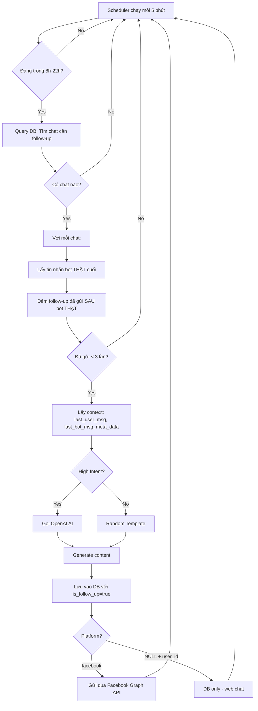

# 🤖 Tài liệu Hoàn Chỉnh: Follow-up System

## 📋 Tổng quan

Hệ thống tự động gửi tin nhắn follow-up khi user đọc tin nhắn nhưng không phản hồi.

**Chiến thuật Hybrid:**

- **High Intent User** → AI sinh nội dung cá nhân hóa
- **Low Intent User** → Template có sẵn

**Platforms hỗ trợ:**

- ✅ Facebook Messenger (Graph API)
- ✅ Web Chat (database only)
- 🔜 Zalo, Email, SMS

---

## 🏗️ Kiến trúc Hệ thống

### Cấu trúc File

```
agents/
  └── follow_up_agents.py        # Cấu hình (delay, templates, AI)

utils/
  ├── follow_up_scheduler.py     # Background scheduler (APScheduler)
  └── facebook_messenger.py      # Facebook API integration

services/
  └── follow_up_service.py       # Logic xử lý follow-up

controllers/
  └── follow_up.py               # API endpoints
```

### Database Schema

**Bảng `messages`:**

```sql
meta_data JSONB:
{
  "is_follow_up": true,           -- Đánh dấu tin nhắn follow-up
  "type": "re_engagement",        -- Loại follow-up
  "strategy": "ai_generated",     -- "ai_generated" | "template_fallback"
  "triggered_at": "ISO timestamp" -- Thời điểm gửi
}
```

**Bảng `chats`:**

```sql
platform: "facebook" | NULL       -- Platform của chat
external_user_id: "FB_USER_ID"    -- Facebook User ID (PSID)
```

---

## ⚙️ Cấu hình

### File: `agents/follow_up_agent.py`

```python
class FollowUpConfig:
    # ===== ĐIỀU KHIỂN BẬT/TẮT =====
    IS_ENABLED = False  # Mặc định TẮT - Bật qua API

    # ===== THỜI GIAN CHỜ =====
    FOLLOW_UP_DELAY_MINUTES = 30    # Chờ 30 phút trước khi gửi
    MAX_FOLLOW_UP_COUNT = 3         # Tối đa 3 lần follow-up

    # ===== KHO TEMPLATE =====
    GENERIC_TEMPLATES = [
        "Alo bạn ơi, bạn còn đó không? Travel AI vẫn đang chờ hỗ trợ bạn nè! 👋",
        "Hình như bạn đang bận? Khi nào rảnh cứ nhắn tin lại cho mình nhé! 😊",
        # ... 6 templates
    ]

    # ===== CẤU HÌNH AI =====
    AI_MODEL = "gpt-4o-mini"
    AI_TEMPERATURE = 0.7
    AI_MAX_TOKENS = 60

    # ===== ĐIỀU KIỆN HIGH INTENT =====
    HIGH_INTENT_KEYS = ['destination', 'price_range', 'dates', 'tours', 'query_type']

    # ===== CẤU HÌNH SCHEDULER =====
    SCAN_INTERVAL_MINUTES = 5       # Quét mỗi 5 phút
    ACTIVE_HOURS_START = 8          # 8h sáng
    ACTIVE_HOURS_END = 22           # 10h tối
```

### Tùy chỉnh Runtime (qua API)

Không cần restart app, có thể thay đổi config qua API:

```python
# Thay đổi delay time
FollowUpConfig.FOLLOW_UP_DELAY_MINUTES = 60  # 1 giờ

# Thay đổi số lần tối đa
FollowUpConfig.MAX_FOLLOW_UP_COUNT = 5
```

---

## 🚀 Khởi động & Quản lý

### 1. Khởi động Manual (Không Auto-start)

Scheduler **KHÔNG** tự động chạy khi app khởi động. Phải bật thủ công qua API.

**Lý do:** Tránh spam khi dev/testing.

### 2. Bật/Tắt qua API

```bash
# Bật follow-up + Start scheduler
POST /api/follow-up/toggle
{
  "action": "enable"
}

# Tắt follow-up + Stop scheduler
POST /api/follow-up/toggle
{
  "action": "disable"
}
```

### 3. Cấu hình Settings

```bash
POST /api/follow-up/config
{
  "delay_minutes": 60,           # Chờ 1 giờ
  "max_count": 2,                # Tối đa 2 lần
  "active_hours_start": 9,       # Bắt đầu 9h sáng
  "active_hours_end": 21         # Kết thúc 9h tối
}
```

### 4. Kiểm tra Status

```bash
GET /api/follow-up/status
```

**Response:**

```json
{
  "status": "success",
  "data": {
    "is_enabled": true,
    "scheduler_running": true,
    "delay_minutes": 30,
    "max_count": 3,
    "active_hours": "8h - 22h"
  }
}
```

---

## 📡 API Endpoints

### 1. GET `/api/follow-up/status`

Xem trạng thái hệ thống

### 2. POST `/api/follow-up/toggle`

Bật/tắt follow-up system

- `action`: "enable" | "disable"

### 3. POST `/api/follow-up/config`

Cấu hình settings

- `delay_minutes`: Thời gian chờ (phút)
- `max_count`: Số lần tối đa
- `active_hours_start`: Giờ bắt đầu (0-23)
- `active_hours_end`: Giờ kết thúc (0-23)

### 4. POST `/api/follow-up/trigger`

Trigger scan ngay lập tức (testing)

### 5. POST `/api/follow-up/manual`

Gửi follow-up cho 1 chat cụ thể

- Body: `{"chat_id": "uuid"}`

---

## 🧠 Logic Hoạt động

### Điều kiện Gửi Follow-up

System chỉ gửi khi **TẤT CẢ** điều kiện sau thỏa mãn:

1. ✅ `FollowUpConfig.IS_ENABLED = True`
2. ✅ Platform = `facebook` (có `external_user_id`) HOẶC Web chat (có `user_id`)
3. ✅ Tin nhắn cuối từ BOT (`role='assistant'`)
4. ✅ Tin nhắn bot cuối KHÔNG PHẢI follow-up (`meta_data['is_follow_up'] != true`)
5. ✅ Đã qua DELAY_MINUTES (30 phút)
6. ✅ Chưa gửi quá MAX_COUNT (3 lần)
7. ✅ Đang trong khung giờ ACTIVE_HOURS (8h-22h)

### Query Logic (SQL)

```sql
-- Tìm tin nhắn bot THẬT (không phải follow-up) mới nhất
SELECT * FROM messages
WHERE role = 'assistant'
  AND (meta_data->>'is_follow_up' IS NULL
       OR meta_data->>'is_follow_up' != 'true')
  AND created_at <= NOW() - INTERVAL '30 minutes'

-- Đếm số follow-up ĐÃ GỬI SAU tin nhắn bot THẬT đó
SELECT COUNT(*) FROM messages
WHERE chat_id = ?
  AND meta_data->>'is_follow_up' = 'true'
  AND created_at > [last_real_bot_message_time]
```

### Chiến thuật Hybrid

#### High Intent (AI Generated)

**Điều kiện:** `meta_data` chứa ít nhất 1 key:

- `destination`, `price_range`, `dates`, `tours`, `query_type`

**Xử lý:**

1. Lấy context từ `meta_data`
2. Gọi OpenAI GPT-4o-mini
3. Prompt: Tạo câu ngắn (<25 từ) gợi mở hội thoại

**Ví dụ output:**

```
Bạn đã xem tour Đà Lạt 3N2Đ chưa ạ? Mình có thể tư vấn thêm nếu bạn cần! 🌸
```

#### Low Intent (Template Fallback)

**Điều kiện:** Không có high intent keys

**Xử lý:**

1. Random pick từ `GENERIC_TEMPLATES`
2. Trả về ngay

**Ví dụ output:**

```
Alo bạn ơi, bạn còn đó không? Travel AI vẫn đang chờ hỗ trợ bạn nè! 👋
```

---

## 🔄 Flow Hoàn Chỉnh



---

## 🐛 Bug Fixes & Solutions

### Bug #1: Spam Follow-up Messages

**Vấn đề:** Follow-up gửi liên tục mỗi phút

**Nguyên nhân:** Query lấy tin nhắn bot cuối bao gồm CẢ follow-up messages

- Tin nhắn cuối = follow-up → đếm từ đó → count = 0 → gửi lại!

**Fix:** Thêm điều kiện lọc follow-up

```python
# Query chỉ lấy tin nhắn bot THẬT
WHERE role='assistant'
  AND (meta_data['is_follow_up'] IS NULL
       OR meta_data['is_follow_up'] != 'true')
```

### Bug #2: Không gửi lên Facebook

**Vấn đề:** Follow-up chỉ lưu DB, không hiện trên Messenger

**Nguyên nhân:** Service chỉ lưu DB, không gọi Facebook API

**Fix:** Thêm logic gửi Facebook

```python
if chat.platform == "facebook" and chat.external_user_id:
    result = asyncio.run(send_facebook_message(
        chat.external_user_id,
        content
    ))
```

### Bug #3: Auto-start gây phiền khi dev

**Vấn đề:** Scheduler tự động chạy mỗi lần restart app

**Fix:** Xóa auto-start trong `app.py`

```python
# TRƯỚC:
@app.on_event("startup")
async def startup_event():
    start_scheduler()

# SAU: Xóa hết, bật thủ công qua API
```

---

## 🧪 Testing

### Test 1: Kiểm tra nhanh (1 phút)

```python
# Sửa tạm trong follow_up_agents.py
FOLLOW_UP_DELAY_MINUTES = 1  # Thay vì 30
```

**Steps:**

1. Enable follow-up: `POST /api/follow-up/toggle {"action": "enable"}`
2. Gửi tin nhắn từ Facebook: "T muốn đi Đà Lạt"
3. Bot reply với tour
4. Đợi 1 phút
5. Check Messenger → Nhận follow-up ✅

### Test 2: Test với API Manual

```bash
# Gửi follow-up cho chat cụ thể
POST /api/follow-up/manual
{
  "chat_id": "your-chat-uuid"
}
```

### Test 3: Kiểm tra AI vs Template

```python
# Test High Intent (AI)
meta_data = {
    "destination": "Đà Lạt",
    "tours": [{"name": "Đà Lạt 3N2Đ"}]
}

# Test Low Intent (Template)
meta_data = {}  # hoặc None
```

---

## 📊 Monitoring & Logs

### Logs quan trọng

```
🔄 [Follow-up Job] Starting at 2025-11-20 10:30:00
🔍 Found 3 chats need follow-up (Facebook + Web registered users)
💰 High Intent detected! Calling AI...
✅ Sent Facebook message part 1/1 to 9165932353535002: 200
✅ Sent follow-up [ai_generated] to Facebook user: ...
📊 Follow-up stats: {'success': 3, 'failed': 0, 'total': 3}
```

### Kiểm tra DB

```sql
-- Xem follow-up messages
SELECT
    m.chat_id,
    c.platform,
    c.external_user_id,
    m.content,
    m.meta_data->>'strategy' as strategy,
    m.created_at
FROM messages m
JOIN chats c ON c.id = m.chat_id
WHERE m.meta_data->>'is_follow_up' = 'true'
ORDER BY m.created_at DESC;
```

### Metrics Analytics

```sql
-- Tỷ lệ reply sau follow-up
WITH follow_ups AS (
  SELECT chat_id, created_at
  FROM messages
  WHERE meta_data->>'is_follow_up' = 'true'
),
user_replies AS (
  SELECT DISTINCT f.chat_id
  FROM follow_ups f
  JOIN messages m ON m.chat_id = f.chat_id
  WHERE m.role = 'user'
    AND m.created_at > f.created_at
)
SELECT
  COUNT(DISTINCT follow_ups.chat_id) as total_followups,
  COUNT(DISTINCT user_replies.chat_id) as replied,
  ROUND(100.0 * COUNT(DISTINCT user_replies.chat_id) /
        COUNT(DISTINCT follow_ups.chat_id), 2) as reply_rate_percent
FROM follow_ups
LEFT JOIN user_replies ON user_replies.chat_id = follow_ups.chat_id;
```

---

## 🛠️ Troubleshooting

### Scheduler không chạy?

**Check:**

1. `GET /api/follow-up/status` → `is_enabled: true`?
2. Logs có `🚀 Follow-up Scheduler started`?

**Fix:**

```bash
POST /api/follow-up/toggle {"action": "enable"}
```

### Follow-up không gửi?

**Nguyên nhân thường gặp:**

| Lỗi               | Check                  | Fix                       |
| ----------------- | ---------------------- | ------------------------- |
| Ngoài giờ         | Current time: 23h      | Đợi đến 8h-22h            |
| Chưa đủ delay     | Last msg: 5 phút trước | Đợi đến 30 phút           |
| Đã gửi đủ 3 lần   | Count = 3              | User không reply → stop   |
| Không có platform | `chat.platform = NULL` | Chỉ gửi Facebook/Web user |
| Tin cuối từ user  | `role = 'user'`        | Đợi bot reply             |

### OpenAI API Error?

**Log:**

```
⚠️ AI Error: ... Falling back to template.
```

**Nguyên nhân:** API key, quota, network

**Fix:** System tự động fallback về Template → Vẫn hoạt động!

---

## 💡 Best Practices

### 1. Thời gian hợp lý

- **30 phút đầu:** Nhẹ nhàng, friendly
- **1 giờ sau:** Hỏi cần hỗ trợ
- **1 ngày sau:** Gửi deal/promotion

### 2. Giới hạn spam

- Max 3 lần → Tránh phiền
- User không rep → Dừng ngay

### 3. Personalization

- High Intent → AI cá nhân hóa
- Mention tour cụ thể
- Tránh generic "Bạn còn đó không"

### 4. A/B Testing

- Test templates khác nhau
- Track: Follow-up → Reply → Booking
- Dùng `strategy` field để phân tích

---

## 🎯 Roadmap

- [x] Facebook Messenger integration
- [x] Web chat support (DB only)
- [x] AI + Template hybrid
- [x] Platform filtering
- [x] API controls
- [ ] Zalo integration
- [ ] SMS/Email fallback
- [ ] A/B testing auto-optimization
- [ ] ML predict reply probability
- [ ] Dashboard analytics

---

## 📞 Support

Có vấn đề? Liên hệ team dev hoặc tạo issue trên GitHub.

**Happy Coding! 🚀**
